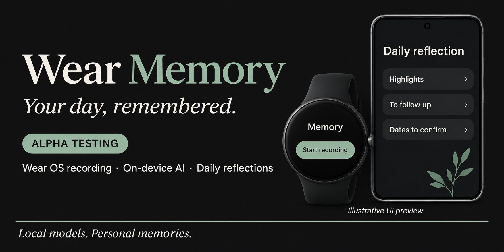

<p align="center"></p>

# Wear Memory

**Wear OS recordings. Private, on-device reflections.**

  

Wear Memory pairs a Wear OS recorder with an Android companion app. Record on your watch, sync to your phone, then use local speech and language models to turn recordings into daily reflections, follow-ups and calendar drafts.

**0.1.1 Alpha — looking for testers.** The APKs compile and their signatures have been checked. Hardware installation, continuous recording, pairing, Cantonese accuracy, overnight completion and battery life have **not yet been verified**. Continuous recording is a development goal; 24-hour operation is not guaranteed.

[繁體中文介紹](#繁體中文) · [Installation](#installation) · [Testing checklist](#help-test-the-alpha) · [Known limits](#known-limits)

## A quieter place to revisit your day

- Watch recording with five-minute file segments and a visible system microphone indicator.
- Phone playback, transcripts and deletion.
- Offline transcription with whisper.cpp; summaries with llama.cpp and a compatible Qwen3 GGUF model.
- Daily/monthly reflections, follow-ups, keywords and dates extracted by the model.
- Calendar drafts for user review before saving.
- Adjustable overnight scheduling and morning status notifications.
- Model import and rollback to a previous model.
- Manual ZIP backup through Android's document picker, including Drive where its provider is available.

These are implemented Alpha paths, not a claim of end-to-end hardware validation.

## Interface preview

The banner uses an **illustrative UI preview**, not a device screenshot. Its English text is promotional artwork; the current app interface is primarily Traditional Chinese. Real device screenshots will be added after hardware testing. Do not treat the artwork as proof of working recording or model performance.

The app uses charcoal surfaces, restrained sage accents and clear date-led typography. No fake usage statistics, decorative waveforms or looping effects.

## Installation

Install the phone APK on an ARM64 Android 11+ phone and the watch APK on a compatible Wear OS watch. Both apps must have matching signatures and be paired through Google Play services.

See [Traditional Chinese installation guide](README_TC.md). [Download the Alpha APKs](https://github.com/jcwl1008/WearMemory/releases/tag/v0.1.1-alpha). **Models are not bundled.** Import a multilingual Whisper ggml `.bin` and a compatible Qwen3 GGUF file on the phone.

Suggested starting point: Whisper small multilingual and Qwen3 1.7B Q4. These are candidates for testing, not benchmark winners on your phone.

- [Whisper model files](https://huggingface.co/ggerganov/whisper.cpp/tree/main)
- [Qwen3 1.7B GGUF](https://huggingface.co/Qwen/Qwen3-1.7B-GGUF)

Start with one short recording, stop, sync, and run manual analysis before testing overnight schedules.

## Help test the Alpha

1. Record 1–5 minutes and confirm playback and transfer.
2. Try Cantonese mixed with English; note incorrect dates, names and product terms.
3. Confirm the transcript and summary refer to the correct recording.
4. Review calendar drafts; check dates manually before saving.
5. Test overnight charging, interruption, reconnect and morning notifications.
6. Only then try longer sessions. Record phone/watch models, OS versions, RAM, model files, elapsed time and battery change.

Use a [bug report](../../issues/new?template=bug_report.yml). **Do not upload private conversations, credentials, access tokens or unredacted logs.** Use a short consented test clip or a text description. Do not include information about other people without permission.

## Known limits

| Area | Alpha status |
|---|---|
| Continuous recording / battery | No 24-hour hardware validation; system interruptions may stop recording |
| Audio storage | Uncompressed PCM: about **2.76 GB per 24 hours**; no automatic retention policy |
| Local AI | CPU inference, user-imported models; accuracy, speed and thermal behavior need testing |
| Scheduling | Android may delay or interrupt work; no exact completion-time guarantee |
| Google Drive | Manual export only; OAuth and automatic nightly backup are not implemented |
| Calendar | Model-generated drafts need review; cancellation, rescheduling and duplicate detection are incomplete |
| Screenshots | No verified device screenshots yet; banner is illustrative |
| Updates | No OTA or production release signing system; CI debug builds may require reinstalling |

Recordings and transcripts live in app-private storage. Android system backup is disabled. There is no cloud-AI fallback. Manual backups leave the app only when you select a destination. System microphone indicators are retained. Record only where participants understand and consent to recording.

## Build

Requires JDK 17+, Gradle 8.10.2, Android SDK/build tools 35, NDK 27.2.12479018 and CMake 3.22.1.

```bash
git clone --recurse-submodules https://github.com/jcwl1008/WearMemory.git
cd WearMemory
# Create local.properties with sdk.dir=/your/android/sdk
gradle :phone:assembleDebug :watch:assembleDebug
```

The phone and watch share application ID `hk.jimmy.wearmemory`. Native dependencies are pinned Git submodules; source packages distributed earlier included the same vendor sources. Never publish signing keys or local.properties.

## Roadmap

- Real-device recording, transfer and model benchmarks
- Compressed audio, storage limits and retention controls
- Reliable sync recovery and deletion tracking
- Structured date validation and calendar duplicate handling
- Drive OAuth, automatic backup and restore
- Verified model downloads, compatibility checks and acceleration
- Stable release signing, migrations and update channels

## Credits and licensing

Original application source is published for Alpha testing. No project-wide open-source license has been selected yet; public visibility alone does not grant a general reuse license. Upstream whisper.cpp and llama.cpp retain their own licenses, included in their pinned repositories. Model downloads have their own license terms.

UI craft adapted from [unslop](https://github.com/heydamir/unslop) by Damir Sokolovsky ([@heydamir](https://x.com/heydamir)), CC BY 4.0. Banner: AI-generated promotional illustration, not a device screenshot.

## 繁體中文

**用手錶記低聲音，喺手機慢慢回看一天。**

Wear Memory 配合 Wear OS 手錶及 Android 手機，將錄音同步到手機，使用手機內模型轉錄，整理每日／每月回顧、待辦、關鍵詞及待確認日期。支援自訂夜間分析與早晨通知、模型匯入及還原，以及手動匯出備份。

**目前係 Alpha 測試版。** 已通過編譯及簽章檢查，未完成實機全天錄音、續航、粵語準確度及夜間分析驗證。錄音暫用未壓縮格式，每 24 小時約 2.76 GB；Google Drive 自動備份尚未完成。系統咪高峰提示會保留。橫幅為介面示意，並非實機截圖。

歡迎先用短錄音試用，再回報裝置、系統、模型版本及問題。請勿公開私人錄音或其他人資料。詳見[安裝說明](README_TC.md)。
